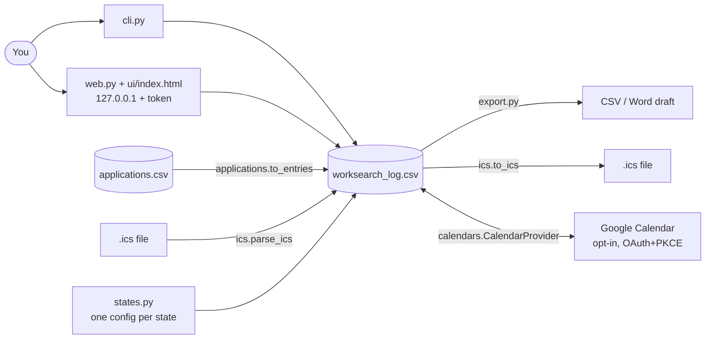

# Architecture

| Module | Job | Network |
|---|---|---|
| `states.py` | A state's form, accepted activities, results, reminders | none |
| `log.py` | `Entry`, ready-to-sign checks, claim weeks, CSV storage, stable ids | none |
| `applications.py` | Application tracker CSV and its conversion to entries | none |
| `ics.py` | Read/write `.ics` | none |
| `export.py` | CSV and Word drafts | none |
| `calendars/` | Provider interface, minimal event payload, Google connector | only when you sign in and run it |
| `web.py`, `cli.py` | Interfaces over the same functions | `127.0.0.1` only |

Design rules: the tool never invents a fact; unknowns stay blank and block "ready to sign"; data stays local; every external connector is opt-in, injectable and tested against a fake.
